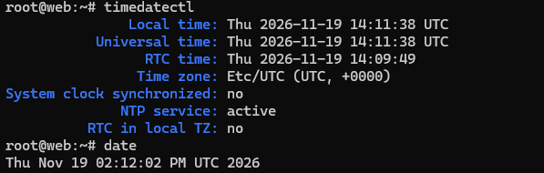
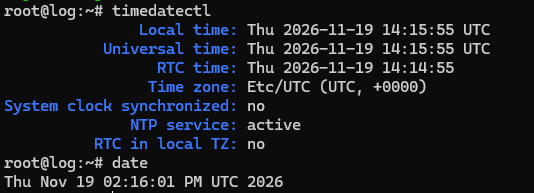
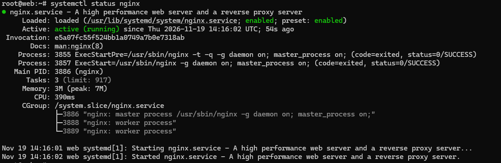
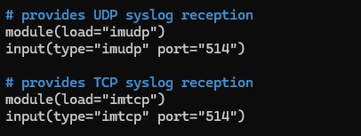
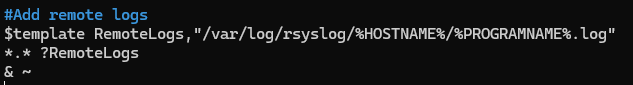
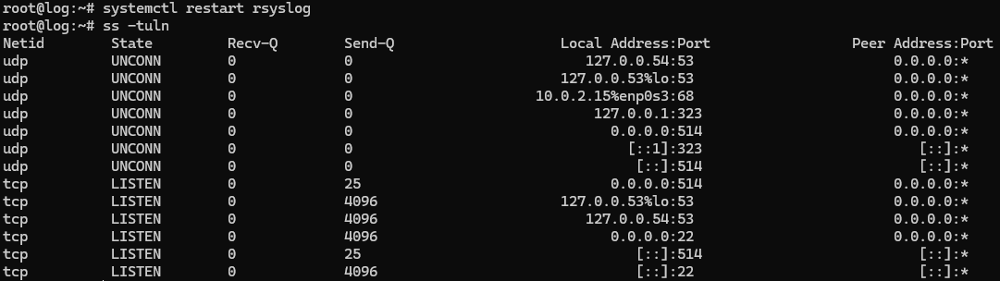
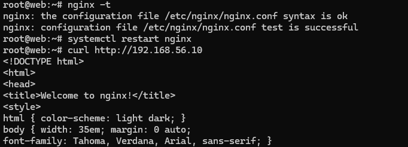
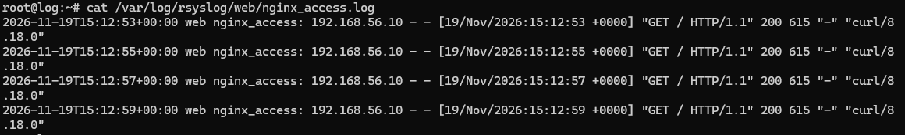
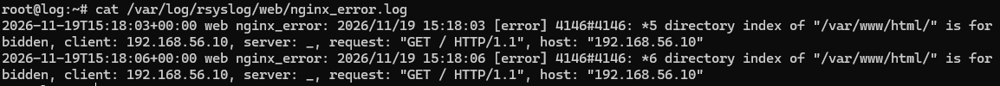

Тема: Основы сбора и хранения логов 

Что нужно сделать?
Поднимаем две машины — web и log.
На web поднимаем nginx.
Настраиваем центральный лог-сервер на любой системе по выбору:
journald;
rsyslog;
elk.
Настраиваем аудит, который будет отслеживать изменения конфигураций nginx.
Все критичные логи с web должны собираться и локально и удаленно.
Все логи с nginx должны уходить на удаленный сервер (локально только критичные).
Логи аудита должны также уходить на удаленную систему.

Формат сдачи ДЗ - vagrant + ansible

Критерии оценки:
Статус "Принято" ставится, если присылаете логи скриншоты без вагранта.

Решение:
Разворачиваем ВМ. Проверяем параметры времени:
```


```
Устанавливаем nginx
```

```
Настраиваем rsyslog /etc/rsyslog.conf 
```


```
Проверяем порты на сервере обработки логов 
```

```
Настроим отправку логов с web-сервера```
error_log /var/log/nginx/error.log;
error_log syslog:server=192.168.56.15:514,tag=nginx_error;
В блоке
http {
access_log syslog:server=192.168.56.15:514,tag=nginx_access,severity=info combined;```

Сохраняем и проверяем
```

```
Проверяем access логи web сервера на сервере обработки логов 
```

```
Проверяем error логи предварительно настроив конфигурацию с ошибкой
```

```
